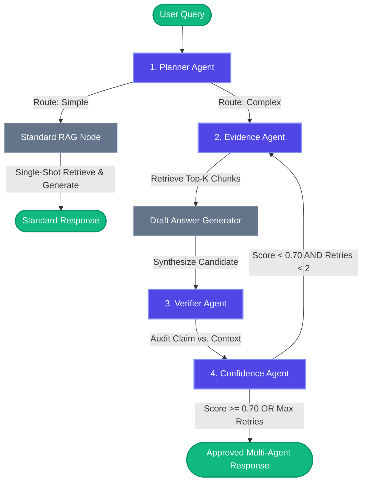

# 🏛️ Multi-Agent Adaptive RAG (MA-RAG) Architecture Specification

This document presents a comprehensive technical breakdown of the architecture, state machines, agent coordination, and conditional routing mechanics powering the **Multi-Agent Adaptive RAG (MA-RAG)** system.

---

## 1. High-Level Architectural Philosophy

Traditional single-agent RAG operates in an open-loop fashion:

$$
\text{Query} \longrightarrow \text{Retrieve}(k) \longrightarrow \text{Generate}
$$

If the retrieved chunks omit necessary bridge entities, the generator either hallucinates plausible falsehoods or produces an incomplete answer.

**MA-RAG** replaces this with a closed-loop, verifiable state machine orchestrated via **LangGraph**:

1. **Dynamic complexity routing**: Only complex, multi-hop queries incur multi-agent evaluation latency.
2. **Adversarial fact verification**: Answers cannot reach the user without passing an independent claim-level audit.
3. **Calibrated uncertainty quantification**: Decisions to re-retrieve or approve rely on mathematical scoring rather than uncalibrated LLM confidence.

---

## 2. Complete Workflow Diagram (LangGraph)



---

## 3. Deep-Dive: The 4 Autonomous Agents

### Agent 1: The Planner Agent (`src/agents/planner.py`)

- **Objective**: Prevent computational overhead by analyzing query syntax, entity dependencies, and multi-hop indicators.
- **Decision Space**:
  - `simple`: Direct factual lookups, single-entity definitions, or single-source questions.
  - `complex`: Multi-hop reasoning, comparative analysis ("both", "same nationality", "which band has more"), or transitive bridge questions ("capital of the country where...").
- **State Output**: Sets `route = "simple"` or `"complex"` and appends diagnostic reasoning to `trace`.

### Agent 2: The Evidence Agent (`src/agents/evidence.py`)

- **Objective**: Retrieve high-relevance paragraphs from persistent **ChromaDB** collections.
- **Adaptive Reformulation**:
  - In initial retrieval ($retry = 0$), queries the vector index with the original user query.
  - In feedback loops ($retry > 0$), analyzes previous failure rationales and dynamically expands the query with missing bridge entities to retrieve previously missed documents.
- **Metrics Computed**: Calculates normalized cosine similarity across top-k chunks:
  $$
  \text{avg\_evidence\_score} = \frac{1}{k} \sum_{i=1}^k \text{similarity}_i
  $$

### Agent 3: The Verifier Agent (`src/agents/verifier.py`)

- **Objective**: Eliminate hallucinations through adversarial fact-checking.
- **Mechanics**:
  - Takes the retrieved evidence and the candidate draft answer as independent inputs.
  - Generates a strict binary verification verdict (`YES` or `NO`), a calibrated agreement score in $[0.0, 1.0]$, and a citation rationale explaining why claims are or are not substantiated.
- **State Output**: Sets `verified: bool` and `verifier_score: float`.

### Agent 4: The Confidence Agent (`src/agents/confidence.py`)

- **Objective**: Synthesize verification accuracy and retrieval similarity into an authoritative confidence metric.
- **Calibration Formula**:
  $$
  \text{Confidence} = 0.6 \cdot \text{verifier\_score} + 0.4 \cdot \text{avg\_evidence\_score}
  $$

  - **Weighting Rationale**: Factual alignment ($60\%$) outweighs raw vector similarity ($40\%$), ensuring that high vector similarity to irrelevant text cannot trigger false approvals.
- **Decision Engine**:
  - If $\text{Confidence} < \text{Threshold}$ (default $0.70$) AND $retry\_count < 2$: Triggers re-retrieval loop back to Evidence Agent.
  - If $\text{Confidence} \ge \text{Threshold}$ OR $retry\_count \ge 2$: Approves the answer and routes to termination.

---

## 4. LangGraph State Schema (`src/state.py`)

All nodes in the pipeline mutate an immutable, strongly-typed state dictionary:

```python
from typing import List, Dict, Any, Optional
from typing_extensions import TypedDict

class AgentState(TypedDict, total=False):
    question: str                   # Original user query
    route: str                      # "simple" or "complex"
    evidence: List[str]             # Top-k retrieved passage texts
    evidence_sources: List[Dict]    # Document metadata, titles, and similarity scores
    draft_answer: str               # Synthesized candidate answer
    verified: bool                  # Verifier Agent fact-check result
    verifier_score: float           # Verifier confidence (0.0 to 1.0)
    avg_evidence_score: float       # Mean vector similarity score
    confidence: float               # Composite weighted confidence
    retry_count: int                # Counter of adaptive retrieval refinement loops
    trace: List[Dict[str, Any]]     # Chronological audit log of all agent decisions
    ground_truth: Optional[str]     # Optional reference answer for evaluation
    is_standard_rag: bool           # Baseline execution flag
    error: Optional[str]            # Connection or execution warning message
```

---

## 5. Conditional Routing Mechanics

### Edge 1: Planner Node Routing

```python
def route_planner_edge(state: AgentState) -> str:
    if state.get("route") == "simple":
        return "standard_rag"
    return "evidence"
```

### Edge 2: Confidence Node Feedback Routing

```python
def route_confidence_edge(state: AgentState) -> str:
    confidence = state.get("confidence", 0.0)
    retry_count = state.get("retry_count", 0)
  
    if confidence < 0.70 and retry_count <= 2:
        return "evidence"  # Loop back for adaptive re-retrieval
    return END             # Approve and terminate
```

---

## 6. Execution Trace Example

```json
[
  {
    "agent": "Planner Agent",
    "action": "Classified question complexity as 'COMPLEX'",
    "status": "COMPLETED",
    "details": {
      "route": "complex",
      "reasoning": "Comparison of two entities across disparate documents."
    },
    "timestamp": "10:14:02.102"
  },
  {
    "agent": "Evidence Agent",
    "action": "Retrieved top-5 chunks (Initial Search)",
    "status": "COMPLETED",
    "details": {
      "chunks_found": 5,
      "avg_similarity_score": 0.89,
      "sources": ["Scott Derrickson", "Ed Wood"]
    },
    "timestamp": "10:14:02.480"
  },
  {
    "agent": "Verifier Agent",
    "action": "Fact-checked draft answer against retrieved evidence: [PASS]",
    "status": "COMPLETED",
    "details": {
      "verified": true,
      "verifier_score": 0.96,
      "rationale": "Evidence explicitly establishes Scott Derrickson is American and Edward Davis Wood Jr. was American."
    },
    "timestamp": "10:14:03.620"
  },
  {
    "agent": "Confidence Agent",
    "action": "Calibrated composite confidence: 93.8% -> APPROVE_ANSWER",
    "status": "COMPLETED",
    "details": {
      "confidence": 0.938,
      "badge_tier": "HIGH (🟢)",
      "decision": "APPROVE_ANSWER"
    },
    "timestamp": "10:14:03.625"
  }
]
```
