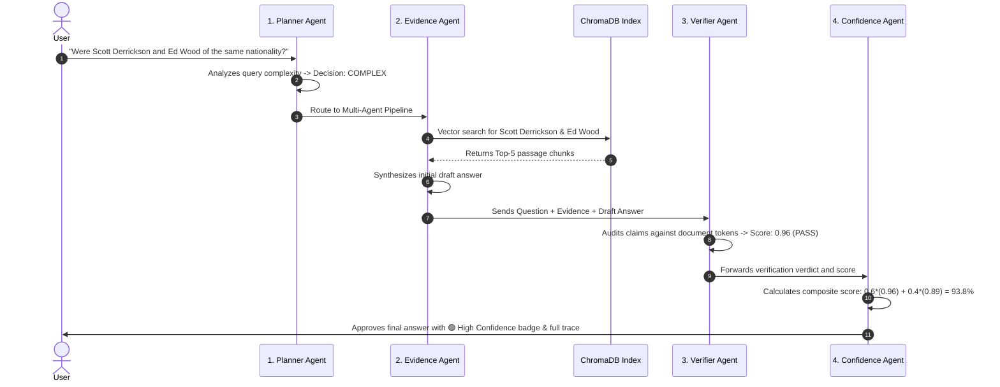

# ⚙️ How the Multi-Agent System Works

This document breaks down the inner workings of the **Multi-Agent Adaptive RAG (MA-RAG)** system in plain, accessible terms.

---

## 1. The 4 Agents Explained

Rather than relying on a single language model to do everything, MA-RAG delegates responsibilities to four specialized, autonomous agents:

```
┌─────────────────┐       ┌─────────────────┐
│ 1. Planner      │ ────> │ 2. Evidence     │
│    Agent        │       │    Agent        │
└─────────────────┘       └─────────────────┘
                                   │
                                   ▼
┌─────────────────┐       ┌─────────────────┐
│ 4. Confidence   │ <──── │ 3. Verifier     │
│    Agent        │       │    Agent        │
└─────────────────┘       └─────────────────┘
```

1. **Planner Agent (`src/agents/planner.py`)**:
   - *Role*: The Traffic Controller.
   - *What it does*: Reads the user's question and assesses its complexity. If a question is simple (single lookup), it routes it to Standard RAG to save time. If the question requires multi-hop entity reasoning or comparison, it routes it to the full 4-agent pipeline.

2. **Evidence Agent (`src/agents/evidence.py`)**:
   - *Role*: The Researcher & Synthesizer.
   - *What it does*: Searches the local ChromaDB vector store for the top-5 most relevant text chunks. During re-retrieval loops, it adapts the search query to hunt for missing bridge clues. It then drafts a concise candidate answer based strictly on the retrieved text.

3. **Verifier Agent (`src/agents/verifier.py`)**:
   - *Role*: The Adversarial Fact-Checker.
   - *What it does*: Evaluates the candidate answer against the retrieved evidence. It acts as an independent judge, verifying whether every claim is explicitly substantiated by the documents, and assigns a factual confidence score between `0.0` and `1.0`.

4. **Confidence Agent (`src/agents/confidence.py`)**:
   - *Role*: The Quality Auditor & Loop Decider.
   - *What it does*: Computes a weighted confidence score ($0.6 \times \text{Verifier Score} + 0.4 \times \text{Evidence Score}$). If the score is below `0.70`, it rejects the answer and sends the system back to the Evidence Agent for a re-search. If high, it approves the answer for the user.

---

## 2. The Workflow: Journey of a Complex Question

Here is how a complex question travels through the multi-agent graph:



---

## 3. The Re-Retrieval Loop

What happens when an initial search fails to find all the facts needed for a multi-hop answer?

### The Problem in Traditional RAG
When a standard RAG system searches for:
> *"What government position was held by the woman who portrayed Corliss Archer in Kiss and Tell?"*

It retrieves the article about the film *Kiss and Tell* and finds that *Shirley Temple* played the role. However, it does not have her political biography. Traditional RAG either guesses (hallucination) or gives up.

### The MA-RAG Solution: Adaptive Feedback
1. **Detection**: The **Verifier Agent** notices that the draft answer cannot prove what government position she held. It returns a low verification score (`0.42`).
2. **Rejection**: The **Confidence Agent** calculates a composite confidence of `0.50`, which is below the `0.70` threshold.
3. **Loop Trigger**: Because `retry_count < 2`, the Confidence Agent triggers a re-retrieval loop.
4. **Adaptive Query Reformulation**: The **Evidence Agent** re-analyzes the query, identifies the missing entity (*"Shirley Temple"*), and executes an expanded query targeting *"Shirley Temple diplomatic career"*.
5. **Recovery**: ChromaDB retrieves Shirley Temple's biography showing she was *"Chief of Protocol of the United States"*.
6. **Final Approval**: The Verifier re-checks the newly synthesized answer, scores it `0.95`, and the Confidence Agent approves it.

---

## 4. Standard RAG vs. MA-RAG: Smart Routing

Not every question needs the full overhead of a 4-agent verification loop.

- **Simple Questions**:
  - Example: *"What is the capital of France?"* or *"When was Python released?"*
  - The **Planner Agent** immediately recognizes single-hop direct queries and sets `route = "simple"`.
  - Simple queries are routed directly to the **Standard RAG Baseline** (direct retrieval $\rightarrow$ direct generation), delivering answers in under 1 second.
- **Complex Questions**:
  - Example: Multi-step entity links, comparisons, and transitive reasoning.
  - The **Planner Agent** flags the query as `complex` and routes it to the full verification pipeline to guarantee factual grounding and zero hallucinations.

This adaptive routing gives you the best of both worlds: **maximum speed for simple queries** and **bulletproof verification for complex queries**.
